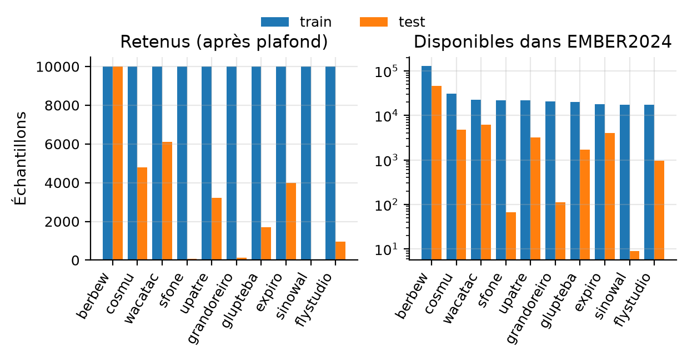
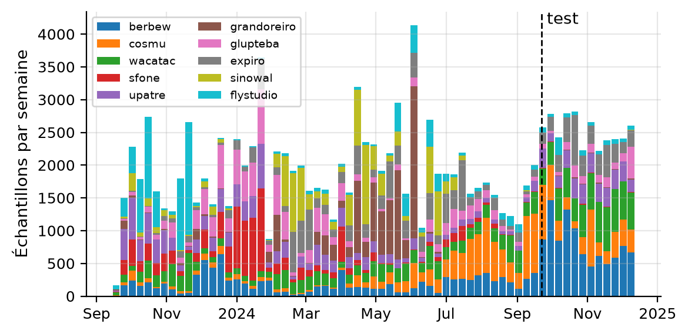
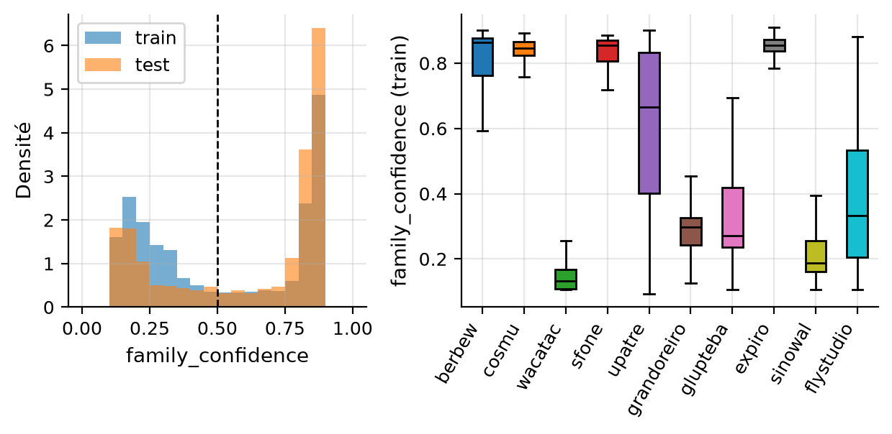

# 2. Données et préparation

*Rôle A. Chiffres obtenus sur le jeu `Win32_top10` (préparation du 18/10/2026), reproduits par
`notebooks/01_exploration.ipynb`.*

## 2.1 Le jeu de données EMBER2024

EMBER2024 [EMBER2024] décrit 3,2 millions de fichiers soumis à VirusTotal entre septembre 2023
et décembre 2024. Il ne contient **aucun exécutable** : chaque fichier y est représenté par une
ligne JSON de caractéristiques statiques déjà extraites (en-têtes, sections, imports, chaînes de
caractères, histogrammes d'octets…). Il se prête donc à un projet d'analyse de malwares sans
manipuler de code malveillant (voir la section Éthique et sécurité).

Chaque fichier porte trois informations utiles au projet :

- un **label** binaire : bénin ou malveillant ;
- pour les malwares, une **famille** (`family`), calculée par ClarAVy [ClarAVy] à partir des
  noms de détection des antivirus, avec un **score de confiance** entre 0 et 1
  (`family_confidence`) ;
- la **date de première soumission** à VirusTotal.

Le découpage entre apprentissage et test est **temporel** : le train couvre les 52 premières
semaines, le test les 12 suivantes (à partir du 22 septembre 2024). Le classifieur est donc
évalué sur des malwares plus récents que ceux qu'il a appris, comme il le serait en conditions
réelles.

Nous n'utilisons que les exécutables Windows 32 bits (**Win32**), le type le plus représenté et
celui pour lequel toutes les features (imports, sections, signature…) ont un sens.

**Tableau 2.1 – Fichiers Win32 d'EMBER2024 (fichiers uniques).**

|                              |     Train |    Test |
|------------------------------|----------:|--------:|
| Fichiers bénins              |   780 000 | 179 994 |
| Fichiers malveillants        |   780 000 | 180 000 |
| Malwares avec une famille    |   685 659 | 159 911 |

## 2.2 Choix des familles et constitution du jeu

**Familles retenues.** Le problème est une classification en **10 familles** : les 10 plus
fréquentes du train. Le test n'intervient pas dans ce choix, pour ne pas biaiser l'évaluation.

**Plafond par famille.** Les effectifs disponibles vont de 17 131 (flystudio) à 128 405 (berbew)
fichiers dans le train, soit un rapport de 7,5. Nous tirons au hasard (graine 0) au plus
**10 000 fichiers par famille** et par partie (train, test). Ce plafond :

- équilibre parfaitement le train (10 000 fichiers par famille) ;
- limite `X_train` à 100 000 lignes, soit environ 1 Go, ce qui tient sur un ordinateur portable.

Le test n'est plafonné que pour berbew (10 000 fichiers sur 46 043) : ailleurs, tous les fichiers
disponibles sont gardés.

**Tableau 2.2 – Effectifs par famille (fichiers uniques).**

| Famille     | Train disponible | Train retenu | Test retenu | Part du test |
|-------------|-----------------:|-------------:|------------:|-------------:|
| berbew      |          128 405 |       10 000 |      10 000 |      32,3 %  |
| cosmu       |           30 393 |       10 000 |       4 781 |      15,4 %  |
| wacatac     |           22 559 |       10 000 |       6 119 |      19,8 %  |
| sfone       |           22 108 |       10 000 |          66 |       0,2 %  |
| upatre      |           21 977 |       10 000 |       3 215 |      10,4 %  |
| grandoreiro |           20 364 |       10 000 |         113 |       0,4 %  |
| glupteba    |           19 907 |       10 000 |       1 706 |       5,5 %  |
| expiro      |           17 717 |       10 000 |       3 983 |      12,9 %  |
| sinowal     |           17 280 |       10 000 |           9 |       0,03 % |
| flystudio   |           17 131 |       10 000 |         956 |       3,1 %  |
| **Total**   |      **317 841** |  **100 000** |  **30 948** |    **100 %** |

*Figure 2.1 – Effectifs par famille : retenus après plafond (à gauche) et disponibles dans
EMBER2024 (à droite, échelle logarithmique).*

**Un test très déséquilibré.** Le train est équilibré par construction, mais le test ne l'est
pas : berbew y compte 10 000 fichiers et sinowal seulement **9**, soit un rapport de 1 111.
sfone (66) et grandoreiro (113) sont aussi très peu représentées. Deux conséquences pour
l'évaluation :

- l'**exactitude** (*accuracy*) est dominée par berbew, wacatac et cosmu, qui forment les deux
  tiers du test : il faut lui préférer le **F1 macro**, le rappel par famille et une matrice de
  confusion normalisée ;
- le score de sinowal repose sur 9 fichiers : une seule erreur fait varier son rappel de
  11 points. Il ne permet pas de conclure sur cette famille.

**Variante à 20 familles.** Pour un problème plus difficile, nous avons aussi préparé les
20 familles les plus fréquentes : 162 778 fichiers en train et 39 513 en test. Les 10 premières
sont exactement celles du jeu de référence, avec les mêmes effectifs et les mêmes indices `y`.
Les scores sur ces 10 familles se comparent donc directement. Les 10 suivantes ont toutes moins
de 10 000 fichiers dans le train, de 4 632 (shipshape) à 8 987 (tempedreve) : le train reste
proche de l'équilibre (rapport 2,2).

**Tableau 2.3 – Familles ajoutées dans la variante à 20 familles (train / test).**

| Famille | Train / test | Famille | Train / test |
|---|---:|---|---:|
| tempedreve | 8 987 / 414 | blackmoon | 6 120 / 620 |
| virut | 7 486 / 2 132 | ekstak | 5 375 / 1 013 |
| barys | 7 193 / 227 | urelas | 4 962 / 300 |
| floxif | 6 843 / 2 754 | ipamor | 4 798 / 626 |
| emdup | 6 382 / 291 | shipshape | 4 632 / 188 |

## 2.3 Chaîne de préparation

La préparation est entièrement automatisée et reproductible, avec trois commandes :

1. **Téléchargement** (`malware_family.download`) : seules les archives `Win32_train.zip`
   (12,3 Go) et `Win32_test.zip` (2,6 Go) sont téléchargées depuis Hugging Face. Chacune est
   vérifiée par sa somme SHA-256.
2. **Préparation** (`malware_family.prepare`) : les fichiers JSONL sont lus directement dans les
   archives, sans décompression sur le disque (64,9 Go de JSON). Seuls les malwares des familles
   retenues sont vectorisés, en parallèle, en un vecteur de **2 568 features** (section 3).
3. **Vérification** (`malware_family.dataset`) : dimensions, cohérence des fichiers, absence de
   valeurs infinies ou manquantes.

Le paquet officiel `thrember` ne s'installe plus avec les versions récentes de ses dépendances et
vectorise tous les fichiers, bénins compris (environ 24 Go en mémoire). Nous avons donc
réimplémenté sa vectorisation sans ses dépendances. Les tests du projet vérifient qu'elle donne
des vecteurs **identiques au bit près** à ceux du code officiel.

Le résultat est un jeu directement utilisable par scikit-learn : matrices `X_train` (100 000 ×
2 568) et `X_test` (30 948 × 2 568) en `float32`, étiquettes `y`, et métadonnées de chaque ligne
(`sha256`, date, famille, confiance, position dans les archives). Les lignes sont triées par date
de première soumission.

## 2.4 Contrôle qualité : doublons et fuite de données

Une première version du jeu comptait 49 658 fichiers de test, mais seulement **30 190 empreintes
`sha256` différentes**. L'analyse a montré que **chaque ligne des archives Win32 figure deux
fois**. Il y a 1 560 000 lignes en double dans le train et 360 006 dans le test. Les effectifs du
tableau 2.1 étaient d'abord doublés : 1 560 000 fichiers bénins et autant de malveillants pour le
train, au lieu de 780 000.

Non corrigé, ce défaut aurait :

- donné deux fois plus de poids à certains fichiers, dans l'apprentissage comme dans l'évaluation ;
- surestimé les petites familles du test (18 « sinowal » pour 9 fichiers réels).

La préparation ne garde donc qu'**une ligne par fichier** (`sha256`). Elle vérifie aussi qu'aucun
fichier du test n'apparaît dans le train, ce qui fausserait l'évaluation : **aucun** cas n'a été
trouvé, le découpage temporel d'EMBER2024 est propre. Un jeu préparé sans cette correction est
désormais refusé au chargement.

## 2.5 Répartition dans le temps

*Figure 2.2 – Nombre d'échantillons retenus par semaine de première soumission, par famille.
Le pointillé marque le début du test.*

Les familles n'apparaissent pas de façon régulière, mais **par vagues**, comme des campagnes :
flystudio en octobre–novembre 2023, sfone de décembre 2023 à février 2024, sinowal au printemps
2024, grandoreiro avec un pic en juin 2024, cosmu surtout à partir de juillet 2024. Dans le test,
sfone, grandoreiro et sinowal ont presque disparu, d'où leurs très faibles effectifs.

Les hauteurs absolues des barres ne reflètent pas le volume réel sur VirusTotal : chaque famille
a été sous-échantillonnée différemment par le plafond. En revanche, la forme de chaque famille
dans le temps est fidèle.

Cette évolution, appelée **dérive temporelle**, est au cœur de l'évaluation. Elle a aussi une
conséquence méthodologique : une validation croisée aléatoire sur le train mélangerait des
fichiers d'une même campagne entre apprentissage et validation, et surestimerait les
performances. Une **validation temporelle** (les dernières semaines du train comme validation)
est plus fidèle.

## 2.6 Qualité des étiquettes

*Figure 2.3 – Confiance des étiquettes de famille (`family_confidence`) : distribution globale
(à gauche) et par famille dans le train (à droite).*

La confiance des étiquettes est **bimodale** : les fichiers ont soit une étiquette très sûre
(autour de 0,85), soit une étiquette douteuse (autour de 0,15–0,3), avec peu d'intermédiaires.
La moitié environ des étiquettes dépasse 0,5 : 48 % dans le train et 65 % dans le test.

**Tableau 2.4 – Part des étiquettes de confiance ≥ 0,5, par famille.**

| Famille     | Train | Test |
|-------------|------:|-----:|
| berbew      |  83 % | 87 % |
| cosmu       |  98 % | 97 % |
| wacatac     |   1 % |  1 % |
| sfone       |  82 % | 42 % |
| upatre      |  67 % | 54 % |
| grandoreiro |   5 % | 80 % |
| glupteba    |  19 % | 60 % |
| expiro      |  96 % | 93 % |
| sinowal     |   4 % | 44 % |
| flystudio   |  28 % | 25 % |

Trois constats :

- berbew, cosmu et expiro ont des étiquettes **fiables** dans les deux périodes ;
- **wacatac** a presque toujours une étiquette douteuse (médiane 0,13). C'est un nom de détection
  générique (`Trojan:Win32/Wacatac` chez Microsoft Defender), donné à des malwares variés : il
  faut s'attendre à des confusions entre wacatac et les autres familles, qui ne seront pas
  forcément des erreurs du modèle ;
- pour **sfone, grandoreiro, glupteba et sinowal**, la confiance **change nettement entre le
  train et le test**. Les fichiers de test de ces familles ne ressemblent donc pas tout à fait à
  ceux du train : c'est une autre facette de la dérive temporelle.

**Variantes à étiquettes sûres.** Pour mesurer l'effet de ce bruit d'étiquetage, nous avons
préparé deux variantes qui ne gardent que les étiquettes de confiance ≥ 0,5 (tableau 2.5).

- **Variante A : mêmes 10 familles, dans le même ordre.** Elle permet une comparaison à familles
  égales. Mais le train y devient déséquilibré : il ne reste que 148 wacatac, 761 sinowal,
  1 052 grandoreiro, 3 799 glupteba et 4 972 flystudio. Le test n'a plus que 4 sinowal, 28 sfone,
  88 wacatac et 90 grandoreiro.
- **Variante B : les 10 familles les plus fréquentes parmi les étiquettes sûres.** Le problème
  change : wacatac, grandoreiro et sinowal sont remplacées par floxif, urelas et eggnog. Même
  ainsi, seules 5 familles atteignent le plafond de 10 000, et eggnog n'a que 2 fichiers de test.

**Tableau 2.5 – Effectifs des variantes à étiquettes sûres (train / test).**

| Famille     | Référence     | Variante A   | Variante B   |
|-------------|--------------:|-------------:|-------------:|
| berbew      | 10 000 / 10 000 | 10 000 / 10 000 | 10 000 / 10 000 |
| cosmu       | 10 000 / 4 781  | 10 000 / 4 643  | 10 000 / 4 643  |
| wacatac     | 10 000 / 6 119  | 148 / 88        | –               |
| sfone       | 10 000 / 66     | 10 000 / 28     | 10 000 / 28     |
| upatre      | 10 000 / 3 215  | 10 000 / 1 731  | 10 000 / 1 731  |
| grandoreiro | 10 000 / 113    | 1 052 / 90      | –               |
| glupteba    | 10 000 / 1 706  | 3 799 / 1 031   | 3 799 / 1 031   |
| expiro      | 10 000 / 3 983  | 10 000 / 3 693  | 10 000 / 3 693  |
| sinowal     | 10 000 / 9      | 761 / 4         | –               |
| flystudio   | 10 000 / 956    | 4 972 / 238     | 4 972 / 238     |
| floxif      | –               | –               | 6 509 / 2 677   |
| urelas      | –               | –               | 4 641 / 279     |
| eggnog      | –               | –               | 3 455 / 2       |
| **Total**   | **100 000 / 30 948** | **60 732 / 21 546** | **73 376 / 24 322** |

Filtrer les étiquettes ne supprime donc pas seulement du bruit : cela retire presque
entièrement certaines familles. Les familles les plus touchées (wacatac, sinowal, grandoreiro)
sont justement celles dont l'étiquette est la moins sûre.

## 2.7 Malwares des autres familles

Le classifieur ne connaît que 10 familles, alors que le test d'EMBER2024 en contient bien
d'autres. **92 920 malwares du test** (58,1 % de ceux qui ont une famille) appartiennent à
3 012 autres familles, dont 390 absentes du train. Ils sont écartés du jeu.

Les plus fréquentes sont virlock, floxif, lummastealer, virut et aenjaris. Nos résultats portent
donc sur un problème **fermé** : en conditions réelles, un tel classifieur recevrait aussi des
malwares d'autres familles et les rangerait à tort dans l'une des 10 qu'il connaît.

## 2.8 Features inutilisables

Sur les 2 568 colonnes, **43 sont constantes** dans tout le train :

- 32 types d'avertissements pefile qui ne se produisent jamais ;
- les deux premiers octets du fichier, toujours `4D 5A` (« MZ »), la signature de tout
  exécutable Windows ;
- 3 minima calculés sur les sections (entropie, taille relative, taille virtuelle relative),
  toujours nuls par construction : la vectorisation officielle ajoute une valeur 0 avant de
  prendre le minimum ;
- 5 caractéristiques jamais rencontrées dans ces familles : deux motifs de chaînes
  (`Start-process`, `base64string`), le drapeau d'exécutable 16 bits, la data directory réservée
  (taille et adresse) et les relocalisations dynamiques.

Elles ne peuvent rien apprendre au modèle et sont retirées avec `VarianceThreshold` de
scikit-learn. La liste est dans `results/features_constantes_Win32_top10.txt`.

S'y ajoutent **207 colonnes presque toujours nulles** (non nulles pour moins de 0,1 % des
fichiers), surtout des cases d'imports hachés (156). Deux colonnes sont constantes dans le train
mais varient dans le test : le modèle ne pourra pas en tirer parti.

## 2.9 Synthèse

| Constat | Conséquence pour la suite |
|---|---|
| Train équilibré (10 000 par famille), test déséquilibré (×1 111) | F1 macro, rappel par famille, matrice de confusion normalisée |
| sinowal (9), sfone (66), grandoreiro (113) quasi absentes du test | Scores par famille non interprétables pour ces trois familles |
| Familles par vagues, dérive temporelle | Validation temporelle plutôt qu'aléatoire |
| wacatac : étiquette générique, peu sûre | Confusions attendues, à discuter |
| Confiance des étiquettes différente entre train et test pour 4 familles | À relier aux erreurs du modèle sur ces familles |
| Filtrer les étiquettes peu sûres vide wacatac, sinowal et grandoreiro | Variante A à familles égales, avec `class_weight` |
| 58 % des malwares du test hors des 10 familles | Limite « monde fermé » à discuter |
| 43 features constantes, 207 quasi nulles | `VarianceThreshold`, et prudence sur les cases hachées rares |
| Doublons dans les archives, aucune fuite train/test | Jeu dédoublonné, évaluation saine |
