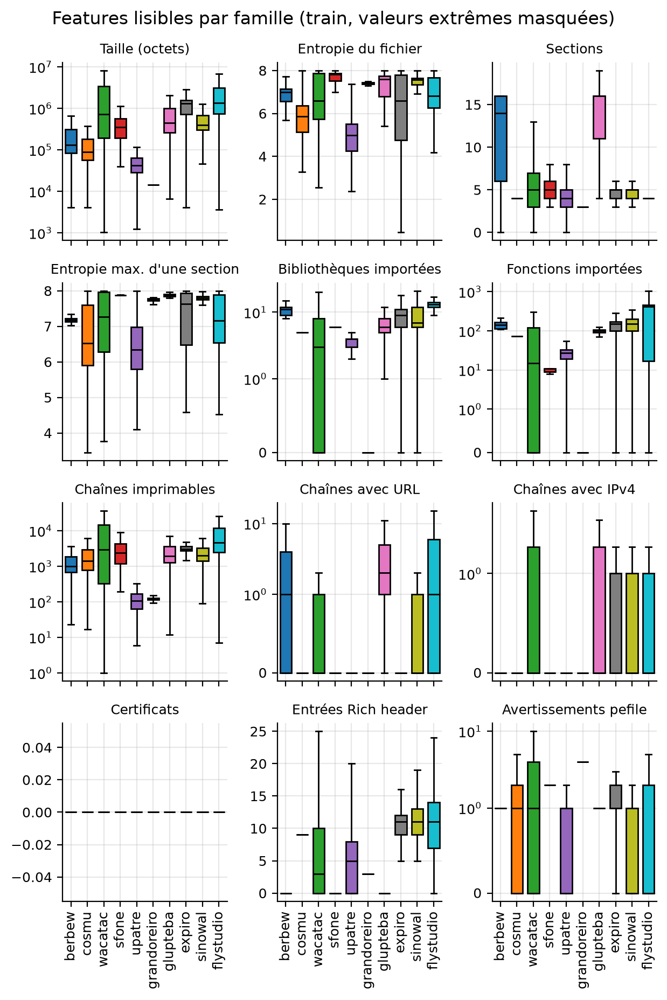
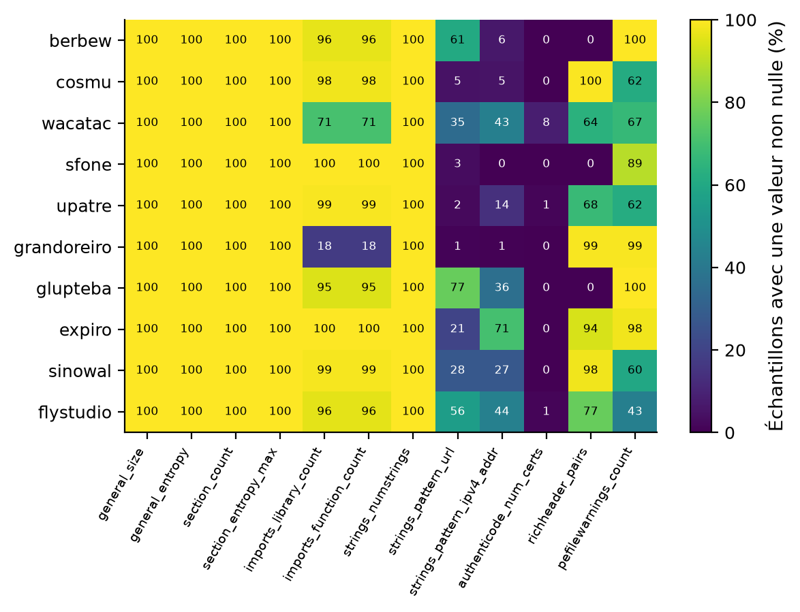

# 3. Features : ce que mesurent les 2 568 colonnes

*Rôle A. Figures et chiffres reproduits par `notebooks/02_features.ipynb` sur le jeu
`Win32_top10` (train).*

## 3.1 Analyse statique et format PE

Toutes nos features sont **statiques** : elles décrivent le fichier tel qu'il est stocké, sans
l'exécuter. Elles viennent pour la plupart de la structure des exécutables Windows, le format
**PE** (*Portable Executable*). Un fichier PE commence par des en-têtes (DOS, COFF, optionnel)
qui décrivent la machine visée, la taille du programme et son point d'entrée. Ces en-têtes sont
suivis de **sections** (code, données, ressources…), d'une **table d'imports** (les fonctions
Windows que le programme appelle) et éventuellement d'une **signature numérique**.

EMBER2024 a déjà extrait ces informations. Notre vectorisation, identique à celle du code
officiel (section 2.3), les transforme en un vecteur de **2 568 nombres** par fichier. Ces
colonnes se répartissent en 12 groupes.

## 3.2 Les 12 groupes de features

**Tableau 3.1 – Groupes de features.**

| Groupe | Colonnes | dont hachées | Ce qu'elles mesurent |
|---|---:|---:|---|
| `general` | 7 | 0 | taille et entropie du fichier, fichier PE ou non, 4 premiers octets |
| `histogram` | 256 | 0 | fréquence de chaque valeur d'octet, de 0x00 à 0xff |
| `byteentropy` | 256 | 0 | histogramme conjoint octet / entropie locale |
| `strings` | 177 | 0 | chaînes imprimables : nombre, longueur, caractères, 77 motifs |
| `header` | 74 | 0 | en-têtes DOS, COFF et optionnel |
| `section` | 224 | 210 | sections : nombre, entropie, tailles, droits, noms ; overlay |
| `imports` | 1 282 | 1 280 | bibliothèques et fonctions importées |
| `exports` | 129 | 128 | fonctions exportées |
| `datadirectories` | 34 | 0 | taille et adresse des 16 répertoires de données |
| `richheader` | 33 | 32 | outils de compilation Microsoft |
| `authenticode` | 8 | 0 | signature numérique |
| `pefilewarnings` | 88 | 0 | anomalies de structure relevées à l'analyse |
| **Total** | **2 568** | **1 650** | |

Le détail de chaque groupe :

- **`general` (7).** Taille du fichier, entropie globale (de 0 à 8 bits par octet), indicateur
  « fichier PE », et valeur des 4 premiers octets.
- **`histogram` (256).** Proportion de chaque valeur d'octet dans le fichier. Un fichier
  compressé ou chiffré a un histogramme presque plat.
- **`byteentropy` (256).** Le fichier est découpé en fenêtres de 2 048 octets. Pour chaque
  fenêtre, on calcule l'entropie, rangée en 16 tranches de 0,5 bit, et on compte ses octets selon
  leurs 4 bits de poids fort (16 valeurs). On obtient ainsi 16 × 16 cases. Ce groupe indique
  **où** se trouvent les zones compressées ou chiffrées, et pas seulement si le fichier en
  contient.
- **`strings` (177).** Nombre et longueur moyenne des chaînes imprimables, distribution de leurs
  96 caractères, entropie. Il compte aussi les chaînes qui contiennent 77 motifs : URL, adresse
  IP, clé de registre, `powershell`, `password`, portefeuille de cryptomonnaie…
- **`header` (74).** Champs des en-têtes : date de compilation, nombre de sections, type de
  machine, sous-système (console, graphique…), tailles du code et de l'image, point d'entrée.
  S'y ajoutent les drapeaux du fichier (16) et de sécurité (11, dont ASLR et DEP), et les
  17 champs de l'en-tête DOS.
- **`section` (224).**
  - 11 résumés : nombre de sections, sections vides, sections à la fois exécutables et lisibles,
    sections modifiables, entropie maximale et minimale, tailles relatives.
  - 210 colonnes hachées, qui associent le nom de chaque section à sa taille, à son entropie et
    à ses droits.
  - 3 colonnes sur l'*overlay* : les données ajoutées après la fin officielle du fichier.
- **`imports` (1 282).** Nombre de fonctions et de bibliothèques importées. Il compte aussi les
  bibliothèques (256 cases) et les fonctions (1 024 cases) importées, rangées par hachage.
- **`exports` (129).** Présence d'exports et fonctions exportées, hachées en 128 cases. Ils
  concernent surtout les bibliothèques DLL.
- **`datadirectories` (34).** Taille et adresse de 16 répertoires de données : imports, exports,
  ressources, signature, relocalisations… S'y ajoutent deux indicateurs de relocalisation.
- **`richheader` (33).** Le *Rich header* est une signature que l'éditeur de liens de Microsoft
  Visual Studio laisse dans l'exécutable. Elle liste les outils et versions utilisés pour
  compiler. Les autres compilateurs (Delphi, Go, MinGW…) n'en produisent pas.
- **`authenticode` (8).** Signature numérique : nombre de certificats, auto-signature, absence
  de contre-signature, profondeur de la chaîne de certificats, dates.
- **`pefilewarnings` (88).** Pour chacun des 87 types d'anomalie relevés par la bibliothèque
  `pefile` (structure incohérente, champ suspect…), une colonne vaut 1 s'il est présent. La
  dernière colonne compte le total.

**Colonnes catégorielles.** Sept colonnes sont des **codes**, pas des quantités : l'indicateur
PE, les 4 premiers octets, le type de machine et le sous-système. Un modèle à base d'arbres les
traite correctement. Pour un modèle linéaire, il faudrait les encoder (*one-hot*).

## 3.3 Le « hashing trick » et l'interprétation des colonnes

Un fichier peut importer n'importe quelle fonction parmi des dizaines de milliers. Pour garder
un vecteur de taille fixe, EMBER2024 utilise le **hashing trick** (`FeatureHasher` de
scikit-learn). Chaque nom est envoyé dans une case calculée à partir de son empreinte :

    case = abs(murmurhash3_32(nom, seed=0)) % nombre_de_cases

Par exemple, `kernel32.dll:VirtualAlloc` tombe dans la colonne `imports_function_hash0581`.
**1 650 colonnes sur 2 568 (64 %)** sont hachées.

Cette technique a deux conséquences pour l'analyse :

- **Une colonne peut regrouper plusieurs noms.** Pour interpréter une colonne hachée importante,
  il faut retrouver les noms qui tombent dans sa case. C'est le rôle de
  `scripts/hash_lookup.py` : il liste, pour chaque case, les noms réellement présents dans nos
  données, avec leur fréquence par famille.
- **Une valeur peut être négative.** Pour les sections, les exports et le Rich header,
  scikit-learn ajoute la valeur d'un nom avec un signe qui dépend de son empreinte. Deux noms de
  signes opposés peuvent se compenser dans une même case. Les cases d'imports, elles, sont
  toujours positives.

Enfin, 43 colonnes sont constantes et 207 presque toujours nulles (section 2.8). Ce sont surtout
des cases hachées rarement remplies et des anomalies `pefile` jamais rencontrées.

## 3.4 Douze features lisibles comparées entre familles

Pour avoir une première idée de ce qui distingue les familles, nous avons comparé 12 features
faciles à interpréter. Il s'agit de pistes descriptives : l'importance réelle des features pour
le modèle est mesurée en section 6.

*Figure 3.1 – Distribution de 12 features lisibles par famille (train, valeurs extrêmes
masquées ; échelle logarithmique pour les tailles et les comptes).*

Beaucoup de ces features valent 0 pour la plupart des fichiers : aucune signature, aucune URL…
Leur boîte se réduit alors à un trait. La part des fichiers où chaque feature est non nulle est
plus parlante.

*Figure 3.2 – Part des fichiers du train (%) pour lesquels chaque feature est non nulle.*

**Tableau 3.2 – Médianes par famille (train).**

| Famille | Taille | Entropie | Sections | Entropie max. section | Bibliothèques | Fonctions | Chaînes | Rich header | Avert. pefile |
|---|---:|---:|---:|---:|---:|---:|---:|---:|---:|
| berbew | 131 Ko | 6,99 | 14 | 7,18 | 11 | 142 | 981 | 0 | 1 |
| cosmu | 90 Ko | 5,87 | 4 | 6,53 | 5 | 72 | 1 410 | 9 | 1 |
| wacatac | 713 Ko | 6,60 | 5 | 7,26 | 3 | 15 | 2 956 | 3 | 1 |
| sfone | 355 Ko | 7,82 | 5 | 7,88 | 6 | 9 | 2 380 | 0 | 2 |
| upatre | 42 Ko | 4,99 | 4 | 6,34 | 4 | 27 | 106 | 5 | 1 |
| grandoreiro | 14 Ko | 7,41 | 3 | 7,75 | 0 | 0 | 121 | 3 | 4 |
| glupteba | 450 Ko | 7,61 | 16 | 7,88 | 6 | 99 | 1 917 | 0 | 1 |
| expiro | 1,3 Mo | 6,60 | 5 | 7,63 | 9 | 151 | 3 054 | 11 | 1 |
| sinowal | 399 Ko | 7,57 | 5 | 7,80 | 7 | 152 | 1 998 | 11 | 1 |
| flystudio | 1,3 Mo | 6,82 | 4 | 7,16 | 13 | 417 | 4 688 | 11 | 0 |

*Taille en octets (Ko = 1 000 octets) ; entropie en bits par octet (maximum 8) ; « Rich header »
= nombre d'entrées.*

Les familles ont des **profils statiques nettement différents** :

- **grandoreiro.** Fichiers minuscules (environ 14 Ko) et presque identiques entre eux, à forte
  entropie. 82 % n'importent aucune fonction et 99 % déclenchent des avertissements `pefile`.
  C'est le profil d'un petit programme chargeur dont le vrai code est chiffré. Ces fichiers
  devraient être faciles à reconnaître.
- **upatre.** Petits fichiers (environ 42 Ko), entropie faible (5,0), très peu de chaînes. C'est
  le profil d'un petit téléchargeur (*downloader*), qui récupère le reste du malware sur
  Internet.
- **sfone.** Entropie proche du maximum (7,8) et seulement 9 fonctions importées : le fichier
  est très probablement **packé**, c'est-à-dire compressé ou chiffré pour cacher son code.
- **glupteba et berbew.** Beaucoup de sections (16 et 14), aucun Rich header, et des
  avertissements `pefile` pour tous les fichiers. Ils n'ont pas été compilés avec Visual Studio.
  Pour glupteba, c'est cohérent avec les analyses publiées, qui le décrivent comme écrit en Go.
  77 % des glupteba contiennent aussi une URL en clair.
- **expiro, sinowal et flystudio.** Gros fichiers, beaucoup d'imports, Rich header de Visual
  Studio : ils **ressemblent à des programmes ordinaires**.
  - expiro est un virus qui infecte des exécutables légitimes : ses features décrivent donc en
    grande partie le programme hôte, ce qui pourrait le rendre plus difficile à classer.
  - flystudio a le plus d'imports (417) et de chaînes (environ 4 700), ce qui correspond au gros
    environnement d'exécution de l'outil de programmation dont il porte le nom.
- **wacatac.** Ses boîtes sont très étalées sur presque toutes les features. C'est cohérent avec
  une étiquette générique qui regroupe des malwares différents (section 2.6).

**Ce qui ne distingue pas les familles.**

- **La signature numérique est quasi absente.** Elle concerne 8 % des wacatac et 0 à 1 % des
  autres familles : aucune famille ne signe ses fichiers.
- **Tous les fichiers sont des PE valides** : `section_count` est non nul pour 100 % d'entre eux.

## 3.5 Pistes pour l'analyse d'importance

D'après cette exploration, les features les plus discriminantes devraient être :

- le nombre de sections et la présence du Rich header : elles reflètent le compilateur ;
- l'entropie, globale et par section, ainsi que les groupes `histogram` et `byteentropy` : ils
  reflètent le packing ;
- le nombre d'imports et les cases d'imports hachées : elles reflètent les fonctionnalités
  utilisées ;
- les avertissements `pefile` et la taille du fichier.

La section 6 vérifiera ces hypothèses avec la mesure d'importance des features, et utilisera
`hash_lookup` pour nommer les colonnes hachées qui ressortent.
