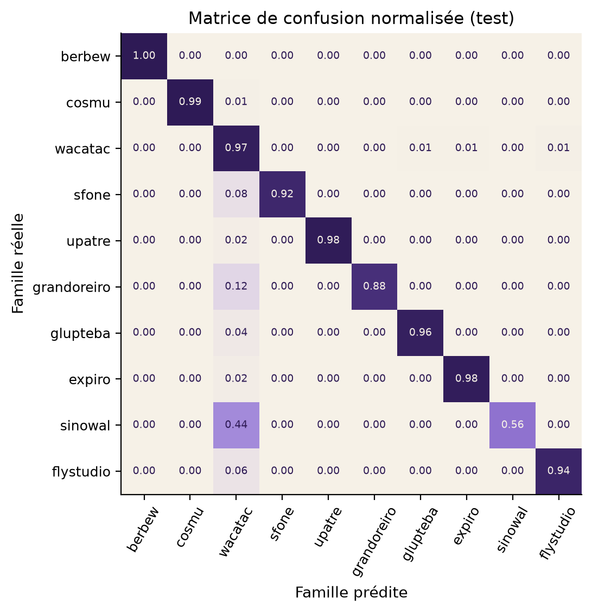

# Rapport : classification de familles de malwares (EMBER2024)

Chaque section est un fichier Markdown. Chacun ne modifie que **ses** fichiers : pas de conflit
git. A assemble le tout à la fin.

## Sommaire et répartition

| Section | Fichier | Responsable | État |
|---|---|---|---|
| 1. Introduction et contexte | `01_introduction.md` | A | premier jet |
| 2. Données et préparation | `02_donnees_preparation.md` | A | premier jet |
| 3. Features : ce que mesurent les 2 568 colonnes | `03_features.md` | A | premier jet |
| 4. Méthodologie (modèles, validation, métriques) | `04_methodologie.md` | B | plan proposé |
| 5. Résultats (scores, confusions, dérive temporelle) | `05_resultats.md` | B | plan proposé |
| 6. Importance des features | `06_importance.md` | C | plan proposé |
| 7. Discussion et limites | `07_discussion.md` | C, avec B | points à développer |
| 8. Éthique et sécurité | `08_ethique_securite.md` | A | premier jet |
| 9. Conclusion | `09_conclusion.md` | A, B et C | à rédiger à la fin |
| Bibliographie | `bibliographie.md` | tous (A relit) | à compléter |
| Soutenance (trame des diapositives) | `diapositives.md` | A coordonne, chacun sa partie | trame prête |

Mettez à jour la colonne « État » quand vous avancez.

## Conventions

- **Langue** : français, « nous » pour l'équipe, phrases courtes, termes techniques expliqués à
  leur première apparition.
- **Titres** : `# N. Titre` pour la section, `## N.k Titre` pour les sous-sections.
- **Figures** : PNG dans `results/figures/`, préfixées par le rôle (`A_`, `B_`, `C_`), créées
  avec `malware_family.figures` : 16 cm de large, 200 dpi, palette violets, ors, beiges et gris,
  une couleur fixe par famille (voir le README du projet, § 6.3). Dans le texte :

  ```markdown
  

  *Figure 5.1 – Matrice de confusion normalisée du modèle final (test).*
  ```

  Numérotation par section (Figure 5.1, 5.2…), légende en italique sous la figure, et chaque
  figure est citée dans le texte.
- **Tableaux** : tableaux Markdown, titre au-dessus (« **Tableau 5.1 – …** »), nombres avec une
  espace pour les milliers (`10 000`) et une virgule décimale (`0,85`).
- **Chiffres** : toujours tirés d'un script ou d'un notebook du dépôt, sur le jeu `Win32_top10`
  dédoublonné (100 000 fichiers en train, 30 948 en test). Indiquez lequel en tête de section.
- **Citations** : clé entre crochets, par exemple [EMBER2024], définie dans `bibliographie.md`.
- **Renvois** : « voir section 2.6 » plutôt que « voir plus haut ».

## Assembler le rapport

Avec [pandoc](https://pandoc.org), depuis le dossier `rapport/` :

```bash
pandoc 0*.md bibliographie.md -o rapport.docx
```

Le fichier Word obtenu contient toutes les sections dans l'ordre, avec les figures. On peut
aussi produire un PDF (`-o rapport.pdf`, il faut alors une installation LaTeX). Le fichier
produit n'est pas versionné : on le régénère.
